# MLOps project: heart disease prediction

End-to-end MLOps pipeline on a Kaggle tabular dataset: preprocessing and training, experiment tracking and model registry with MLflow, local serving, a FastAPI REST API with a web form, Docker, and deployment to Azure Container Instances.

**Dataset:** [Heart Failure Prediction](https://www.kaggle.com/datasets/fedesoriano/heart-failure-prediction) (918 rows, 11 features, binary target `HeartDisease`). Chosen because it mixes numeric and categorical features (real preprocessing to do), has a data quality issue to handle (zeros meaning "missing"), and only 11 inputs, which keeps the form usable.

```
 heart.csv ─► Notebook ─► MLflow tracking (mlflow.db + mlruns/)
                │              │ runs: params, metrics, artifacts, model, dataset
                │              ▼
                │         Model Registry: heart-disease-classifier @champion
                │              │                         │
                │              ▼                         ▼
                │   mlflow models serve :5001     export ─► model/
                │   POST /invocations                       │
                │                                           ▼
                │                         FastAPI (app/) :8000 ─ form at /
                │                                           │
                │                          Dockerfile ─► image ─► ACR ─► ACI
                │                                                   http://<fqdn>:8000
```

> **Screenshots:** every step below has an image slot showing the result on my machine. The images live in `screenshots/`; replace each placeholder file with your own capture using the same file name.

## Project structure

```
mlops-heart-disease/
├── notebooks/01_train_track_serve.ipynb   Parts 1-3: data, training, MLflow, local serving, export
├── data/                                  put heart.csv here (or let the notebook download it)
├── model/                                 champion model exported by the notebook (baked into the image)
├── app/
│   ├── main.py                            FastAPI: /, /predict, /health, /info, /docs
│   ├── static/index.html                  the form (calls /predict with fetch)
│   └── requirements.txt
├── deploy/
│   ├── deploy_aci.sh                      ACR + ACI deployment
│   └── test_endpoint.py                   smoke test, local or Azure
├── screenshots/                           proof that each step worked (used in this README)
├── Dockerfile
├── requirements.txt                       training environment (pinned)
└── .dockerignore / .gitignore
```

## Step 0: environment

Use Python 3.11 or 3.12. The `FROM` line in the Dockerfile must match the version you train with (it is set to `python:3.11-slim`; change it to `3.12-slim` if you train on 3.12). The exact version MLflow recorded is in `model/python_env.yaml`.

```bash
cd mlops-heart-disease
python -m venv .venv
source .venv/bin/activate          # Windows: .venv\Scripts\activate
pip install -r requirements.txt
```

**Result:** virtual environment activated and dependencies installed.

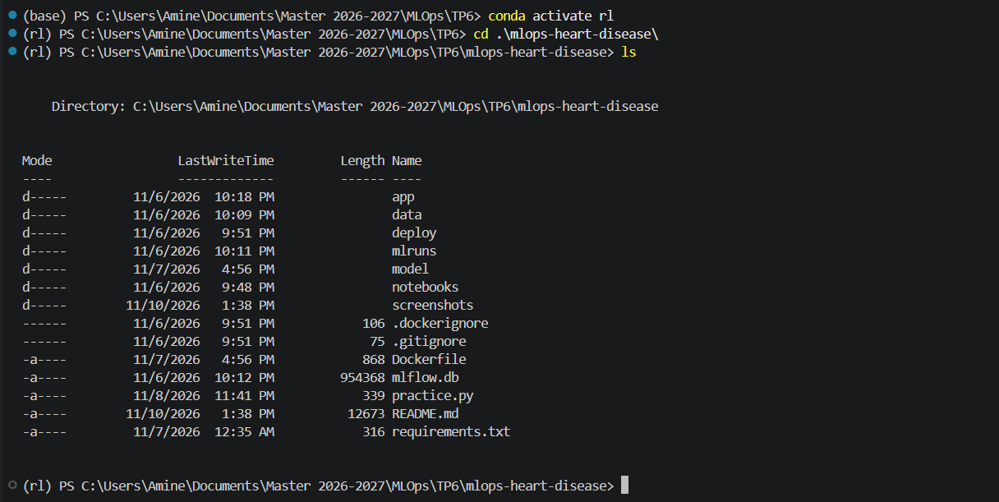

Get the data: download `heart.csv` from Kaggle into `data/`, or let the notebook download it with `kagglehub`.

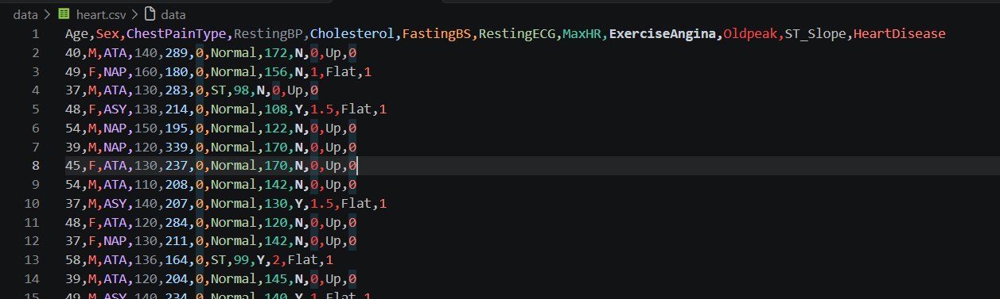

## Steps 1 to 3: train, track, register, serve (notebook)

```bash
jupyter lab notebooks/01_train_track_serve.ipynb
```

**Result:** notebook running, EDA plots and the preprocessing pipeline.

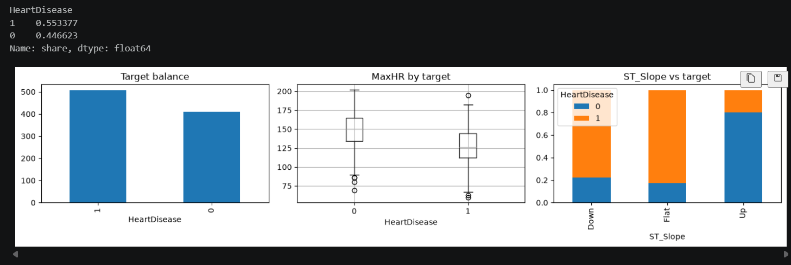

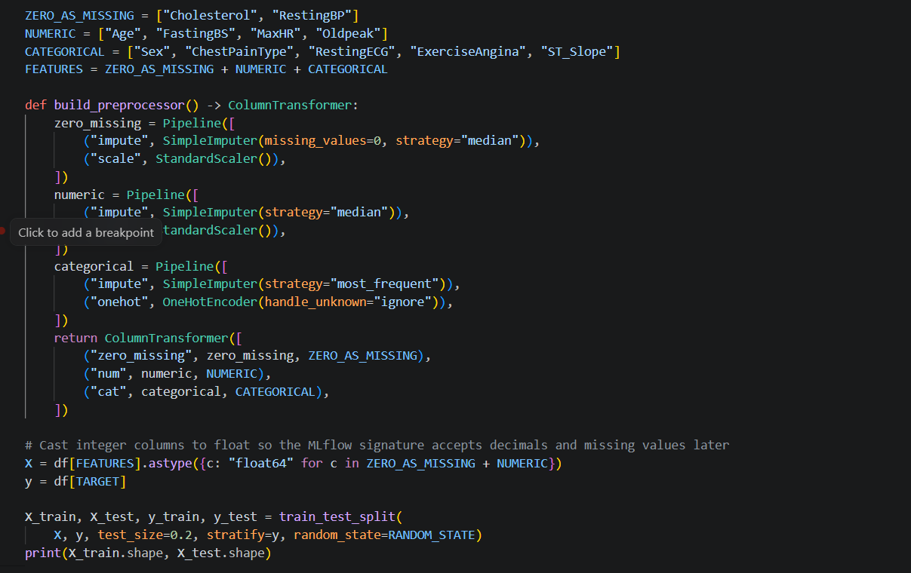

Run all cells. The notebook explains each step; here is what to understand for your report.

**Preprocessing lives inside the model.** Imputation, scaling and one-hot encoding are in an sklearn `Pipeline` with the classifier. The logged model takes raw values, exactly what the form sends, so training and serving can never preprocess differently (training/serving skew is one of the most common bugs in production ML).

**One run per experiment.** Each model or hyperparameter set is one MLflow run with its parameters, metrics (cross-validated and test), artifacts (confusion matrix, classification report), the training dataset, and the model with its signature and an input example. Open the UI to explore them:

```bash
mlflow ui --backend-store-uri sqlite:///mlflow.db --port 5000
```

**Result:** MLflow UI at http://127.0.0.1:5000 with the experiment's runs.

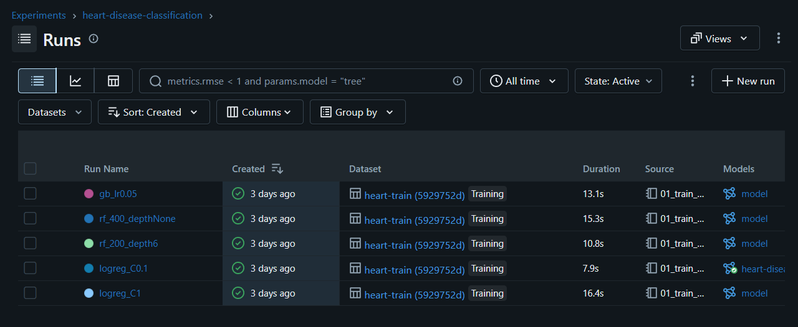

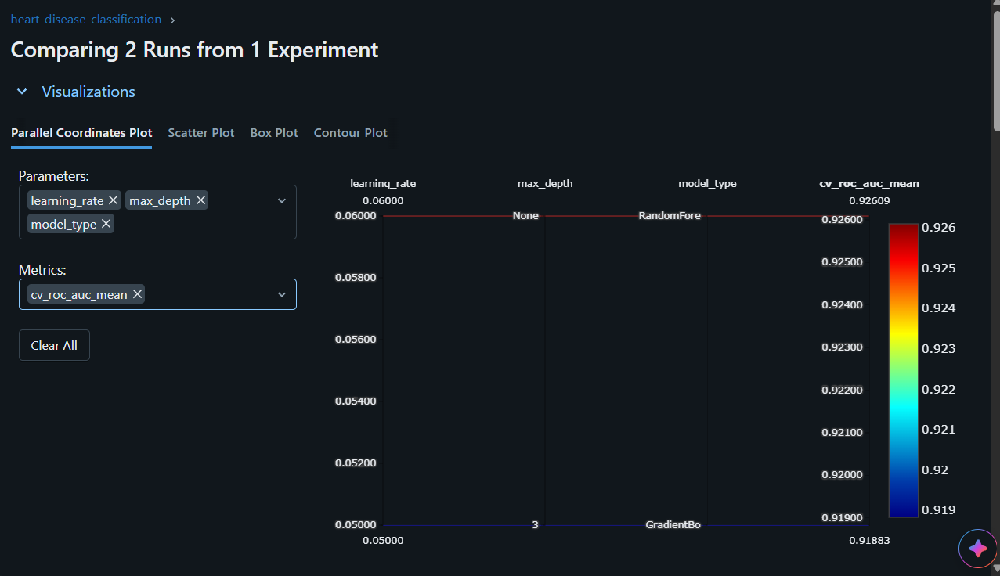

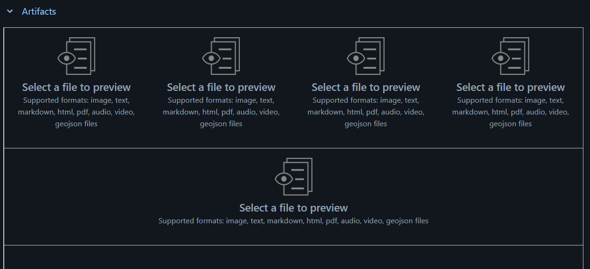

**Registry and alias.** The best run's model is registered as `heart-disease-classifier` and gets the alias `@champion`. Everything downstream asks for `models:/heart-disease-classifier@champion`. Deploying a better model later means registering version 2 and moving the alias, with no code change.

**Result:** registered model with its version and the `@champion` alias.

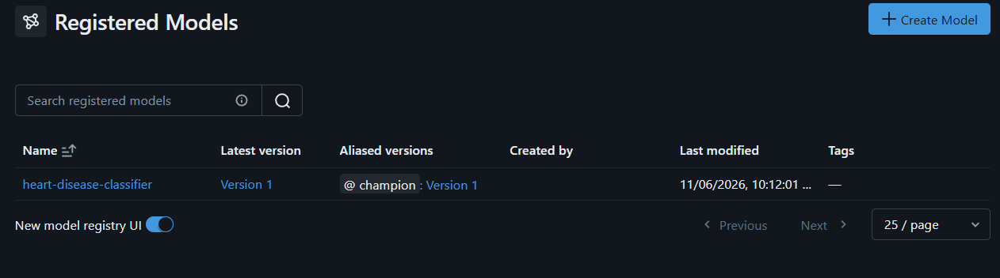

**Local serving with MLflow.** The notebook starts the server itself, but for the report, also run it in a terminal:

```bash
export MLFLOW_TRACKING_URI=sqlite:///mlflow.db        # PowerShell: $env:MLFLOW_TRACKING_URI="sqlite:///mlflow.db"
mlflow models serve -m "models:/heart-disease-classifier@champion" -p 5001 --env-manager local
```

**Result:** MLflow model server listening on port 5001.

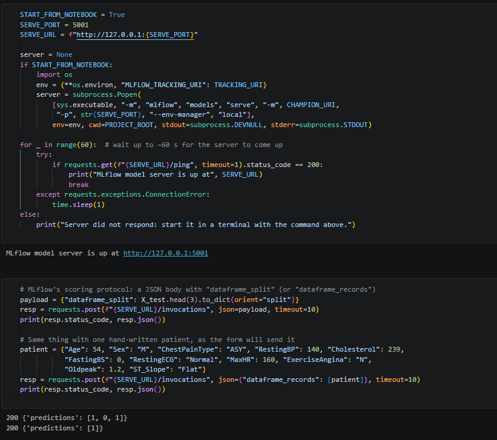

```bash
curl -X POST http://127.0.0.1:5001/invocations -H "Content-Type: application/json" \
  -d '{"dataframe_records": [{"Age": 54, "Sex": "M", "ChestPainType": "ASY", "RestingBP": 140, "Cholesterol": 239, "FastingBS": 0, "RestingECG": "Normal", "MaxHR": 160, "ExerciseAngina": "N", "Oldpeak": 1.2, "ST_Slope": "Flat"}]}'
```


**Export.** The last cells copy the champion into `model/` with a `model_info.json` (name, version, run id, scores). That folder is what goes into Docker.

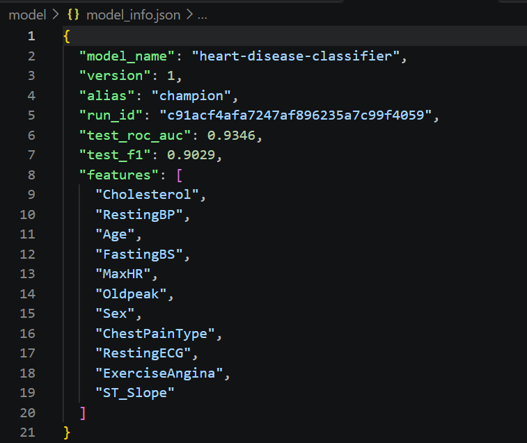

## Step 4: REST API and form (FastAPI)

```bash
uvicorn app.main:app --reload --port 8000
```

**Result:** API started and model loaded at startup.


| URL | What it does |
|---|---|
| http://127.0.0.1:8000 | the form |
| http://127.0.0.1:8000/docs | Swagger UI, generated automatically from the Pydantic schema |
| `POST /predict` | prediction + probability + model version |
| `GET /health` | liveness check (used by the Docker healthcheck) |
| `GET /info` | which registered version is being served |

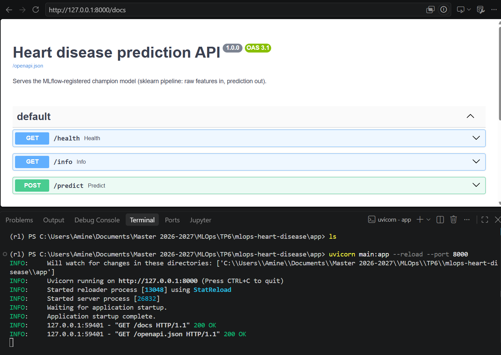

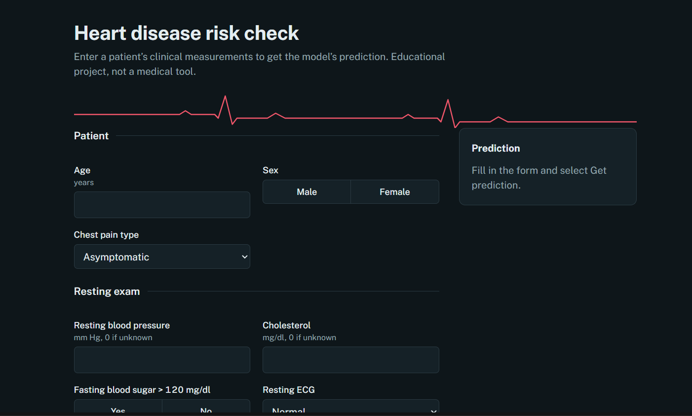

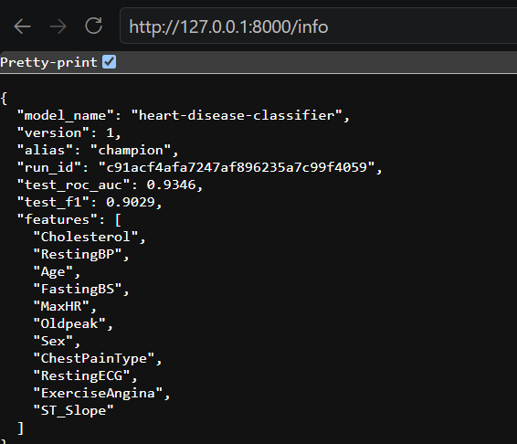

Points worth explaining in your report: the model is loaded once at startup (`lifespan`), not per request; Pydantic validates every field (allowed categories, numeric ranges) and returns a 422 before bad data reaches the model; `/info` gives traceability from a prediction back to the MLflow run.

Test it:

```bash
python deploy/test_endpoint.py
```

**Result:** all smoke tests pass against the local API.

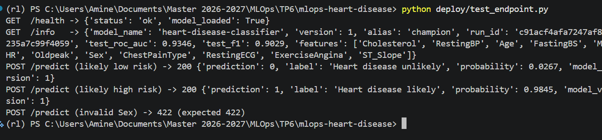

**Why not just call `mlflow models serve` from the form?** You could, but a custom API lets you validate inputs with a business-friendly schema, return probabilities and labels, add endpoints like `/health` and `/info`, and serve the form from the same origin (no CORS issues).

## Step 5: Docker, then Azure Container Instances

### 5a. Build and run locally

```bash
docker build -t heart-api:v1 .
```

**Result:** image built successfully.

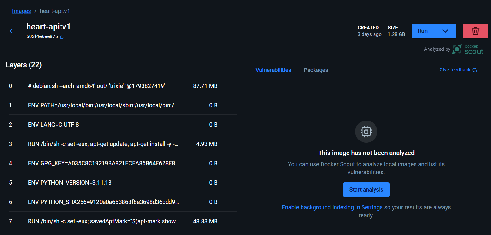

```bash
docker run --rm -p 8000:8000 heart-api:v1
```

**Result:** container running and healthy.

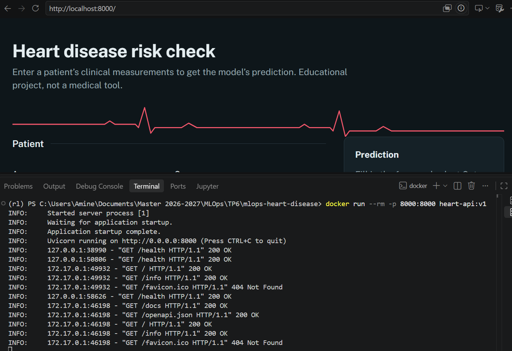

```bash
python deploy/test_endpoint.py
```

**Result:** the container answers the smoke tests.

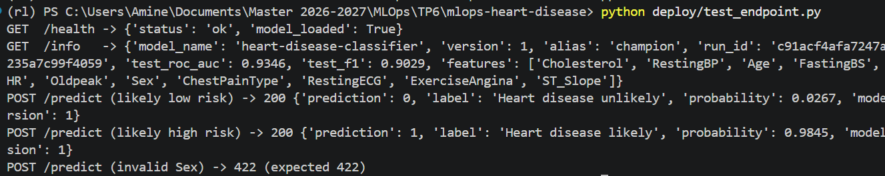

The Dockerfile installs the model's dependencies from `model/requirements.txt`, which MLflow generated at training time with the exact versions used. It installs dependencies before copying the code (better layer caching), runs as a non-root user, and declares a `HEALTHCHECK`.

### 5b. Deploy to Azure

Install the [Azure CLI](https://learn.microsoft.com/cli/azure/install-azure-cli), then:

```bash
az login
```

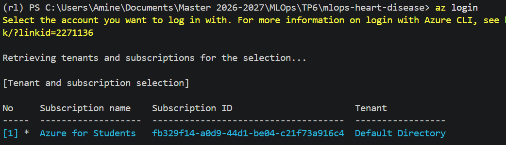

```bash
bash deploy/deploy_aci.sh             # on Windows: run it in Git Bash or WSL
```

**Result:** resource group, registry and container instance created; the script prints the public URL.

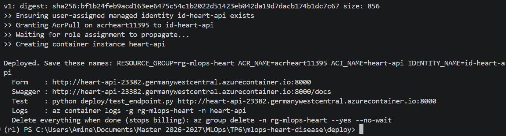

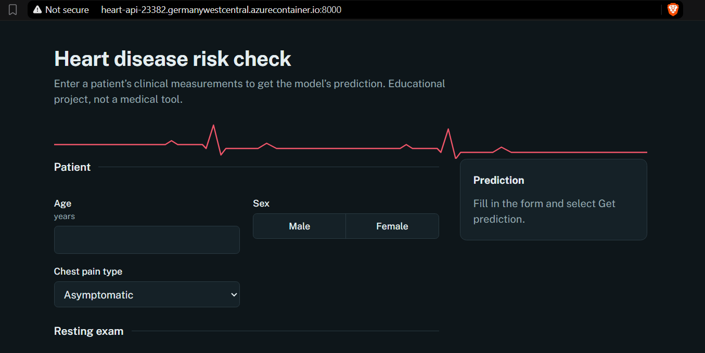


The script creates a resource group, an Azure Container Registry, builds the image in Azure (`az acr build`, so no local Docker push is needed), and runs it on ACI with a public DNS name. At the end it prints the URL. Test it:

```bash
python deploy/test_endpoint.py http://<your-fqdn>:8000
```

**Result:** smoke tests pass against the Azure endpoint.

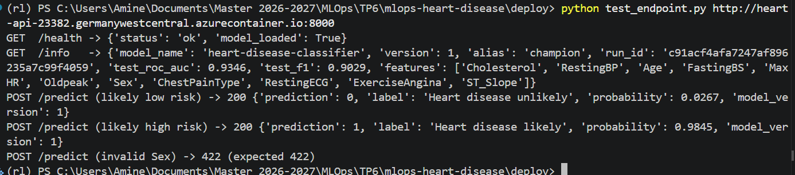

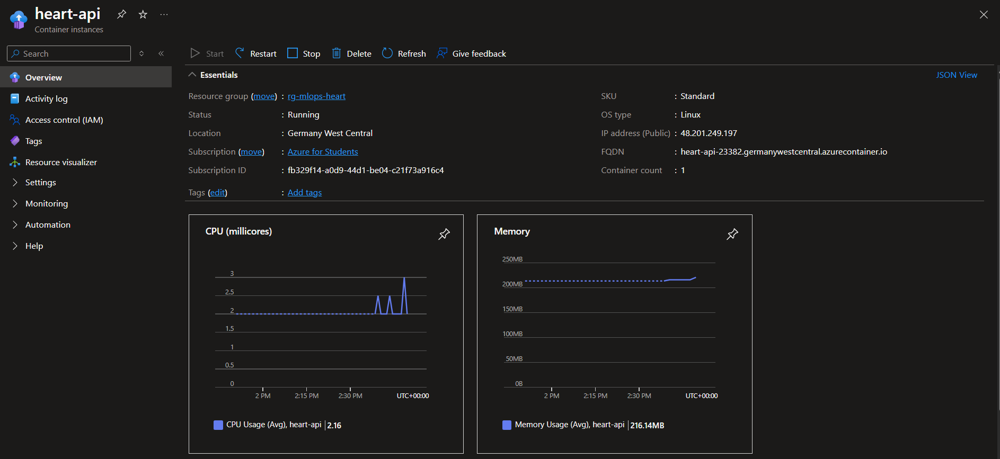


**Delete the resources when you're done**, or they keep consuming credit:

```bash
az group delete -n rg-mlops-heart --yes --no-wait
```

Disclaimer : I chose to show my subscription ID and other information, its just a dummy account, but I'm aware of the security risks and that's not something i would do in a production environment :)
